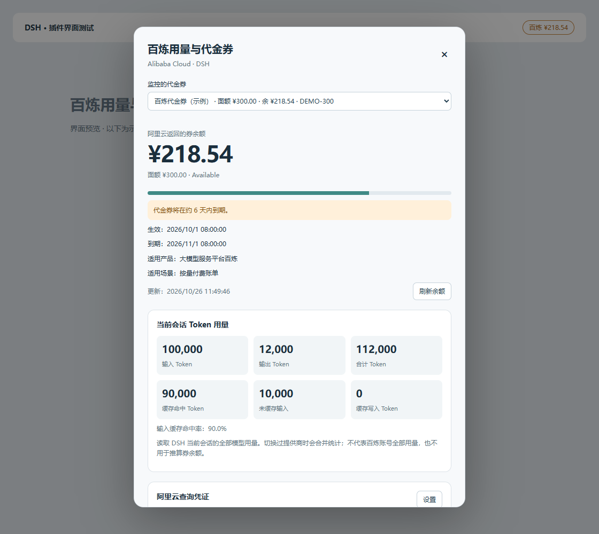

# DSH 百炼代金券余额

在 DeepSeek Harness（DSH）聊天顶部查看阿里云百炼代金券余额、有效期和当前会话的 Token 用量。



## 功能

- 查询阿里云返回的代金券真实余额、面额、有效期、适用产品和场景，可选择要监控的券。
- 余额约每分钟刷新；余额不高于面额的 10%、距离到期不超过 7 天时提示。
- 查询失败保留旧余额及原更新时间，并标记“旧数据”；未知余额显示“—”。
- 展示当前会话的输入、输出、缓存命中和缓存写入 Token，以及输入缓存命中率。
- 入口仅位于已有聊天的顶部，不在侧边栏增加常驻按钮。
- 在插件面板里配置、更换和移除查询凭证。凭证留在本机 DSH 凭证库。

## 安装

已验证 DSH 桌面版 **0.2.1-rc.3** 和 **0.2.2-rc.5**。运行时需要 Node.js 22 或更高版本；桌面版使用其自带运行时，无需另外安装 Node.js。

完全退出 DSH 后，在终端运行：

```sh
dsh plugin --profile desktop add github:Conch-23/dsh-bailian-monitor#v0.1.4
```

Windows 桌面版如果找不到 `dsh` 命令，可调用安装目录内的入口。将下面的安装目录替换成你自己的：

```powershell
& 'D:\DeepseekHarness\resources\runtime\cli\bin\dsh.cmd' plugin --profile desktop add github:Conch-23/dsh-bailian-monitor#v0.1.4
```

重新打开 DSH，进入一个已有聊天，点击顶部的“百炼用量”。首页和新会话准备页没有聊天标题栏，因此不显示按钮。

如果已经装过本地版，先移除旧安装记录，再从 GitHub 安装，避免包管理器继续沿用旧的本地链接：

```sh
dsh plugin --profile desktop remove dsh-bailian-monitor
dsh plugin --profile desktop add github:Conch-23/dsh-bailian-monitor#v0.1.4
```

移除安装记录不会删除本插件已保存的查询凭证和选券记录。请不要在面板中点击“移除插件凭证”，除非你也想清除这些凭证。

仓库直接包含运行所需的 JavaScript，安装不需要编译或执行构建脚本。也可以从 [Releases](https://github.com/Conch-23/dsh-bailian-monitor/releases) 下载 `.tgz`，然后通过 `dsh plugin --profile desktop add '安装包绝对路径'` 安装。

## 首次配置

1. 用代金券所属的阿里云账号打开 [RAM 用户管理](https://ram.console.aliyun.com/users)，创建一个程序访问专用的 RAM 用户及 AccessKey。
2. 创建自定义权限策略，内容使用仓库中的 [ram-policy.json](ram-policy.json)，并将它授予该 RAM 用户：

   ```json
   {
     "Version": "1",
     "Statement": [
       {
         "Effect": "Allow",
         "Action": ["bss:DescribeCoupons"],
         "Resource": "*"
       }
     ]
   }
   ```

3. 点击聊天顶部的“百炼用量”，在“阿里云查询凭证”设置中填写 AccessKey ID 和 AccessKey Secret，点击“保存并查询”。常规 AccessKey 的 Security Token 留空；使用 STS 临时凭证时需填写，并在凭证过期后更新。
4. 从“监控的代金券”下拉框中选择自己的券。

这里需要阿里云 RAM AccessKey。百炼调用模型的 `sk-…` API Key 不能代替账单查询凭证。不要把实际密钥放进仓库、Issue 或截图中。第一次配置后，可与阿里云控制台核对一次余额。

## 数据范围

**代金券余额**直接来自阿里云 `QueryCashCoupons`，不会用“券面额减去本地费用估算”冒充。它与现金余额不同，出账和抵扣也可能存在延迟；是否可抵扣仍取决于券的适用规则及阿里云账单。插件不会在余额耗尽时自动停止模型调用。

**Token 用量**来自 DSH 当前会话的 `tokenUsage` 投影，包含该会话使用过的全部模型。它不是百炼账号的所有请求，也可能遗漏没有归入该投影的后台调用。输入各桶互不重叠；合计为未缓存输入 + 缓存命中 + 缓存写入 + 输出，不再额外叠加推理 Token。

## 更新与卸载

建议使用带版本号的 GitHub 标签安装。新版本发布后，将安装命令中的 `#v0.1.4` 替换成目标标签并重新安装，再重启 DSH。

通过 GitHub 安装后，运行文件保存在 DSH 用户配置的包目录中，不再依赖应用安装目录下的源码。它能避免应用更新清理本地源码目录造成的失效；如果未来 DSH 修改插件接口，仍可能需要适配插件。

卸载命令：

```sh
dsh plugin --profile desktop remove dsh-bailian-monitor
```

如果还要清除本地查询凭证，卸载前在插件设置中点击“移除插件凭证”。这只删除本地记录，不会撤销云端 AccessKey。

## 常见问题

| 现象 | 处理方式 |
|---|---|
| 找不到按钮 | 进入已有聊天；确认插件已启用，并在安装后完整重启 DSH。 |
| `cannot resolve profile bundle` | 从 GitHub 重新安装，核对 DSH 的插件安装列表中是否仍指向已删除的本地目录。 |
| `NotAuthorized` / `Forbidden` | 核对 `bss:DescribeCoupons` 授权及费用中心访问权限。 |
| `NotApplicable` | 核对阿里云账号站点、代金券归属及券类型，并非所有优惠权益都由这个接口返回。 |
| “旧数据” | 最近查询失败，显示的是此前成功查询的余额及时间。可稍后刷新。 |

## 凭证与网络

插件使用 DSH 本地凭证库，记录键为 `bailian-monitor/account`。沿用 DSH 自带的存储方式，不额外承诺系统密钥环加密。Secret 不会返回给用量面板、写入对话或错误诊断信息。

只向 `https://business.aliyuncs.com/` 发送 `QueryCashCoupons` 签名查询，没有购买、充值、退款、修改代金券或调用模型的接口，也没有遥测服务。面板请求沿用 DSH Connection 的所有者权限检查。

## 开发和验证

无第三方运行时依赖，浏览器界面复用 DSH 提供的 React。使用 Node.js 22 或更高版本运行：

```sh
npm test
```

测试覆盖签名、券有效期、缺失余额、并发与缓存、失败保留旧值、凭证更换、接口校验及错误信息脱敏。Host 加载、访问检查和卸载清理已用 DSH 0.2.2-rc.5 的实际 Loader、Connection 和凭证组件验证。界面截图使用虚构数据。

官方参考：[DSH 插件打包与安装](https://github.com/deepseek-ai/deepseek-harness/blob/master/docs/user/develop/basic/publish.md)、[阿里云代金券接口](https://help.aliyun.com/zh/user-center/developer-reference/api-bssopenapi-2017-12-14-querycashcoupons)、[BSS 签名机制](https://help.aliyun.com/zh/user-center/developer-reference/signature)。

## 许可证

[MIT](LICENSE)
